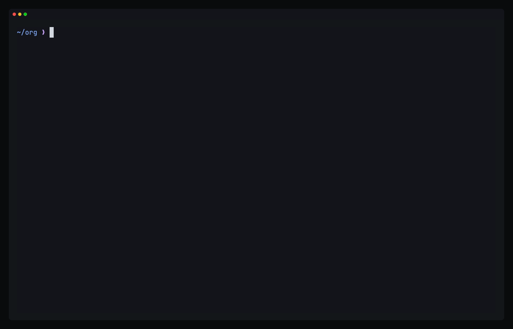

# fude-org

Org mode for fude, as a plugin. It has fude build the org grammar, edits
headings, TODOs and checkboxes, and shows an agenda of the org files in one
folder, with a capture into its inbox.



## Build

```sh
oku sync && oku allow   # Go, TinyGo and binaryen, as fude pins them
fude plugin build       # writes fude-org.wasm
```

It needs fude's API after v0.3.0, so `go.mod` points at a fude checkout
beside this one, `../fude`, until the next release.

## Install

Add this table to fude's `config.toml`:

```toml
[[plugin]]
path = "/path/to/fude-org/fude-org.wasm"
capabilities = ["buffer.read", "buffer.write", "ui", "fs.read", "fs.write", "process", "keys", "grammar"]
programs = ["open"]
paths = ["~/org"]
```

- `grammar` lets fude build the org grammar from
  [nvim-orgmode/tree-sitter-org](https://github.com/nvim-orgmode/tree-sitter-org).
  The grammar runs in fude itself, outside the plugin's sandbox. With
  `auto_install` on, it builds when you open an org file. Otherwise
  `:grammar install org` builds it.
- `paths` is the folder of your org files, which the agenda reads and
  capture writes to.
- `process` and `programs` let a web link open with `open`, or with
  `xdg-open` on Linux, set as the `opener` option too.
- `keys` lets `<Tab>` and `<S-Tab>` run fude's fold cycling. A guest of a
  shared session may not use a plugin granted `keys`.

Keep the file named `fude-org.wasm`. Its options and the agenda's keys are
named after it.

## Use

In an org file:

| Keys | What they do |
|---|---|
| `<Tab>` | on a heading, steps its section from closed, to open with its subheadings closed, to all open |
| `<S-Tab>` | steps the file from top headings, to every heading, to everything |
| `cit`, `ciT` | puts the next or the previous TODO keyword on the heading |
| `<C-Space>` | ticks the list item's checkbox, or clears it |
| `>>`, `<<` | adds a star to the heading, or takes one off |
| `>s`, `<s` | does the same to the heading and every heading under it |
| `<Leader>oJ`, `<Leader>oK` | moves the heading and its subtree past the next or the previous heading of its level |
| `ah`, `ih` | a heading and its subtree, or the subtree without the heading, for an operator such as `d` or `y` |
| `]]`, `[[` | goes to the next or the previous heading |
| `][`, `[]` | goes to the next or the previous heading of the section's level |
| `g{` | goes to the section's heading, or from a heading to the one it is under |
| `<Leader><CR>` | adds a heading after the heading's subtree, or an item after the list item |
| `<Leader>oih`, `<Leader>oit`, `<Leader>ois` | adds a heading, a TODO heading or a subheading after the section's subtree |
| `<S-Up>`, `<S-Down>` | raises or lowers the heading's priority, or moves the part of a timestamp under the cursor |
| `<S-Right>`, `<S-Left>` | puts the next or the previous TODO keyword on the heading, or moves a timestamp a day |
| `<C-a>`, `<C-x>` | moves the part of a timestamp under the cursor, n of its unit |
| `<Leader>o,` | asks for the section's priority |
| `<Leader>ot` | asks for the section's tags, from those it has |
| `<Leader>op`, `<Leader>oP` | sets a property in the section's drawer, or removes one |
| `<Leader>os`, `<Leader>od` | asks when the section is scheduled or due |
| `<Leader>o.`, `<Leader>o!` | puts an active or an inactive timestamp at the cursor |
| `<Leader>o#` | counts again what the section's `[/]` and `[%]` count |
| `<CR>` | follows the link under the cursor |
| `<Leader>ols`, `<Leader>oli` | stores a link to the section's heading, or asks for a link, from the one stored, and a description, and puts it at the cursor |

Off a heading, a list item or a timestamp, each key does what it does in
any other file, so `<Tab>` still jumps forward, `>>` still indents and
`<C-a>` still adds to a number.

Type a date as in org: `2026-11-02`, `+3d`, `-1w`, `today`, `tomorrow` or a
weekday such as `fri`. A time such as `10:00`, a repeater such as `+1w` and
a warning such as `-2d` may follow it. An empty answer removes the date.

A heading put to a done keyword gets `CLOSED:` with the time. One whose
`SCHEDULED:` or `DEADLINE:` date repeats moves that date on instead and
keeps its TODO keyword: `+1w` a week, `++1w` past today, `.+1w` a week from
today. `LAST_REPEAT` notes when. A file's own `#+TODO:` line sets its
keywords.

A `[/]` or `[%]` in a heading counts the checkboxes in its text, or with
none, its children with a TODO keyword. In a list item it counts the
checkboxes of the items under it. `<C-Space>` and `cit` count again as they
change one.

A link is `[[target][description]]` or `[[target]]`, and shows as its
description, or its target, except on the cursor's line. Its target is a
heading of the file as `*title`, a heading's `CUSTOM_ID` as `#id`, a web
address, or a file, `file:` before it or not, with `::*title`, `::#id`, a
line number or text after it to go to in the file.

Anywhere:

| Keys | Command | What it does |
|---|---|---|
| `<Leader>oa` | `:OrgAgenda` | shows what is overdue, due today, this week and later, then the TODOs with no date |
| `<Leader>oc` | `:OrgCapture [text]` | adds a TODO to the inbox, the text typed after it or asked for |

In the agenda, `<CR>` opens the heading on the cursor's line, `t` puts the
next TODO keyword on it in its file, and `r` gathers the agenda again.

## Options

Set them in the table's `options`, such as
`options = { directory = "~/notes", inbox = "~/notes/inbox.org" }`, or with
`:set fude-org.directory ~/notes`.

| Option | Default | What it is |
|---|---|---|
| `todo` | `TODO \| DONE` | the TODO keywords, those after `\|` done, for files with no `#+TODO:` line. The plugin reads it when it loads. |
| `log_done` | `true` | a heading put to a done keyword gets `CLOSED:` with the time |
| `opener` | `open` | the program that opens a web link, which `programs` must hold |
| `directory` | `~/org` | the folder the agenda reads, which `paths` must hold |
| `inbox` | `~/org/inbox.org` | the file capture adds to |

## Not yet

The agenda lists TODO headings, and headings with a `SCHEDULED:` or
`DEADLINE:` date on the line after them. It has no week view, clocking,
tags view or custom views. There are no refile,
archive, capture templates, tables, export or code blocks yet.

## Check

```sh
fude plugin build && go test ./test/
```

## Demo

`demos/org.tape` records the clip above with
[VHS](https://github.com/charmbracelet/vhs): `vhs demos/org.tape` from the
repo root, with VHS, ttyd and ffmpeg on PATH. `demos/setup.sh` runs hidden
first. It builds fude from `../fude` and this plugin, and gives them a
throwaway HOME under `/tmp/fude-org-demo` with notes dated from today, so
a recording never touches your config or your notes. The tape builds the
org grammar out of view, which needs git, tree-sitter and the network.
